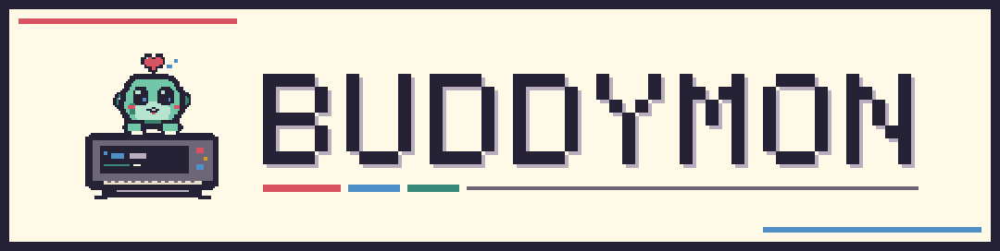
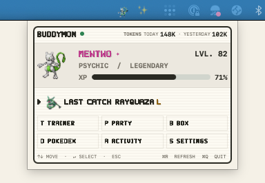
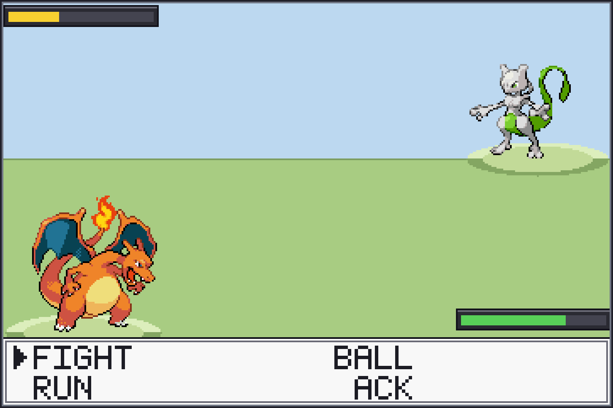
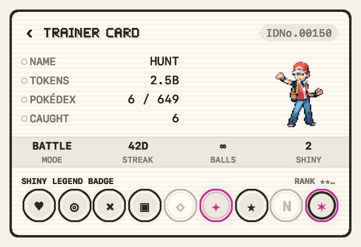
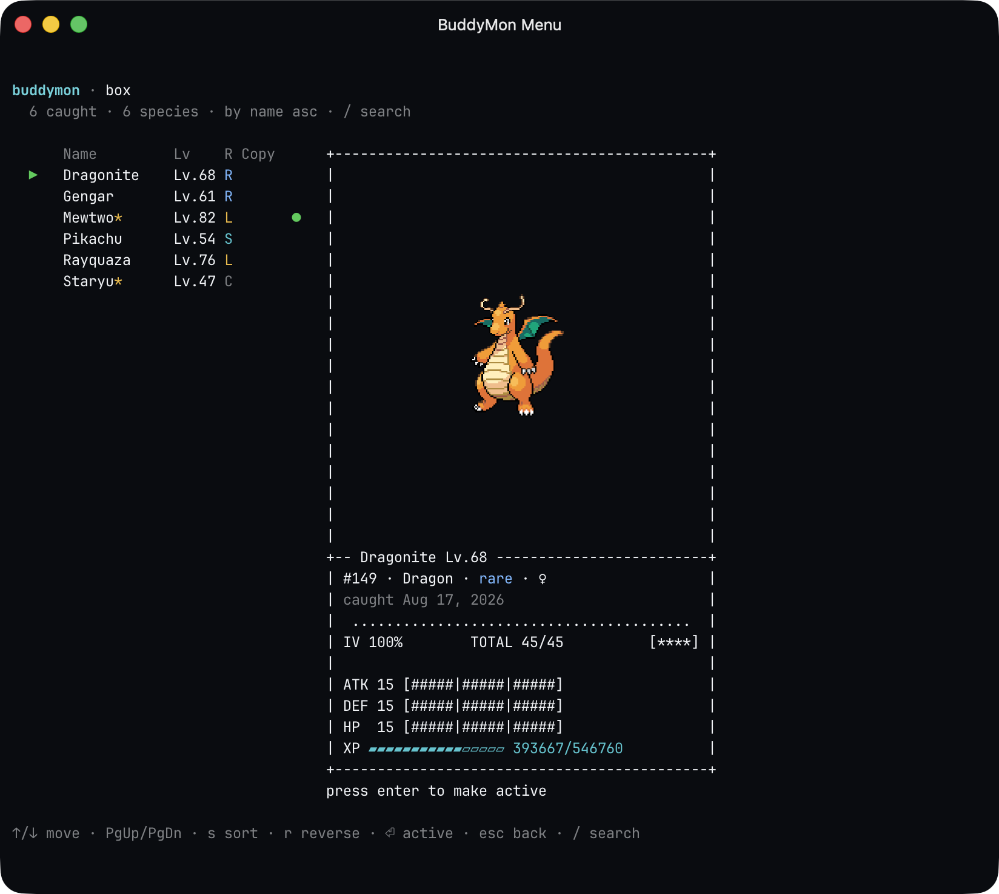
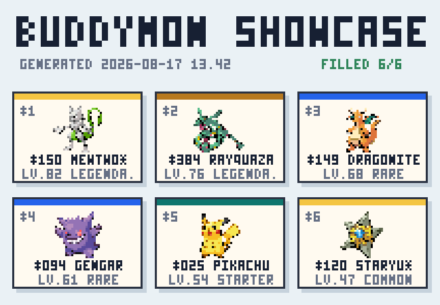

<h1 align="center">
  
</h1>

<p align="center">
  <strong>Turn local AI coding sessions into a Pokémon-style companion game.</strong><br>
  Work with Claude Code, Codex CLI, or Auggie, earn XP, and build a collection that stays on your Mac.
</p>

<p align="center">
  
</p>

<p align="center">
  <sub>A shiny Mewtwo in your menu bar. One click opens your buddy, progress, and latest catch. Captured with demo state.</sub>
</p>

##  Start Playing

### macOS menu-bar app

Keep BuddyMon open while you use **Claude Code**, **Codex CLI**, or **Auggie**.
Your new activity earns progress automatically. No plugin needed.

- **macOS 13+** on Apple Silicon or Intel.
- **Python included** in the self-contained app.
- **Pokémon artwork downloads automatically** on first launch.

**Release status:** `0.2.0` is unreleased; there is no downloadable GitHub Release
yet. The DMG will be linked here after final checks.

#### Build from source

Until the download is available, you'll need:

- Git and Python 3
- Xcode or Command Line Tools, including Swift and the macOS SDK
- Internet access for the bundled runtime and artwork

```bash
git clone https://github.com/HVNT/buddymon.git ~/buddymon
cd ~/buddymon
scripts/build-macos-app.sh --friend --install --open
```

This installs BuddyMon in **Applications** for your current Mac.
[Universal builds and packaging →](docs/development.md)

#### First launch

1. **Choose a buddy.** Click BuddyMon in the menu bar; there's no Dock icon.
2. **Start playing.** Artwork appears as it downloads. No setup command needed.
3. **Keep coding.** Leave BuddyMon open to collect new activity.

**Download interrupted?** Click **Retry**, or reopen BuddyMon. Completed artwork
and your progress stay saved.

### Optional Claude Code plugin

The plugin adds Claude's terminal statusline and immediate turn-end updates.
It is not needed for Codex CLI, Auggie, or normal Mac app play. After cloning
the repository above, launch `claude` and run:

```text
/plugin marketplace add ~/buddymon
/plugin install buddymon@buddymon
/buddymon:choose bulbasaur
```

Other starters are `charmander`, `squirtle`, `pikachu`, and `eevee`. The plugin
invokes `python3`, so Python 3 must be available on `PATH` before Claude starts.

##  The Loop

1. Supported local coding activity becomes XP.
2. Your buddy levels up and evolves while you work.
3. Wild encounters appear in Quick, Safari, or Battle mode.
4. Every catch becomes an individual Pokémon with a stable IV appraisal.
5. Choose favorites for your party and six-slot Showcase.

<p align="center">
  
</p>

<p align="center">
  <sub>Encounters and their results stay inside the compact native panel.</sub>
</p>

##  Your Trainer Card

Your collection, coding streak, shinies, and earned badges—all on one card.
Select a badge to see what you've unlocked.

<p align="center">
  
</p>

<p align="center">
  <sub>The native Trainer Card, captured with demo progress and downloaded Trainer Red artwork.</sub>
</p>

##  A Collection Worth Opening

Party, Box, Pokédex, Activity, and Showcase open directly in the terminal. On a
roomy display, BuddyMon uses a larger window and larger sprite budget; smaller
displays fall back automatically. Box keeps every caught copy distinct and
supports IV sorting and searches such as `iv:82`, `stars:3`, or `perfect`.

<p align="center">
  
</p>

<p align="center">
  <sub>A real 112-by-38 Ghostty handoff rendered from isolated demo state.</sub>
</p>

Your Showcase is a six-slot trophy room assembled from specific Pokémon in your
Box. Sharing creates a labeled PNG on your Desktop; BuddyMon never uploads it.

<p align="center">
  
</p>

<p align="center">
  <sub>An actual local Showcase export from the deterministic demo collection.</sub>
</p>

##  Works With

| Client | Game progress | Token Usage | Collection path |
| --- | --- | --- | --- |
| Claude Code | Local collection; optional plugin hooks | Yes | App, service, or `collect` |
| Codex CLI | Local collection | Yes | App, service, or `collect` |
| Auggie | Local collection | Yes | App, service, or `collect` |
| Gemini CLI | No | Yes | Read-only reporting |

The first collection anchors existing client logs instead of turning old history
into a surprise level-up. Claude's app collector and optional plugin share a
cursor, so running both does not award the same activity twice.

##  Local by Default

- Normal play reads local transcripts and local BuddyMon state.
- Game state is not uploaded and no BuddyMon account is required.
- AI-tool settings are never rewritten.
- The open Mac app collects activity automatically; collection after quitting is opt-in.
- The Mac app downloads Pokémon artwork during first launch, then uses local copies.

State, journey history, and optional packs live under
`$XDG_STATE_HOME/buddymon`, or `~/.local/state/buddymon` when
`XDG_STATE_HOME` is unset.

##  Essential Commands

Slash commands below are for the optional Claude Code plugin. Python commands
run from a source checkout; normal Mac app play does not require them.

| Command | Purpose |
| --- | --- |
| `/buddymon:status` | Show the current buddy and encounter |
| `/buddymon:mode <quick\|safari\|battle>` | Change encounter mode |
| `/buddymon:switch <name>` | Change the active buddy |
| `/buddymon:official` | Manually install artwork for plugin-only play; automatic in the Mac app |
| `python3 buddymon.py menu` | Open the terminal game |
| `python3 buddymon.py collect` | Collect new Claude Code, Codex CLI, and Auggie activity |
| `python3 buddymon.py tokens` | Show local token totals |

##  Documentation

- [macOS app](docs/macos-app.md)
- [Assets](docs/assets.md)
- [Architecture](docs/architecture.md)
- [Development](docs/development.md)
- [Public release QA](docs/release-qa.md)
- [Troubleshooting](docs/troubleshooting.md)
- [Brand styles](docs/brand.md)
- [Decisions](docs/decisions.md)
- [Changelog](CHANGELOG.md)

## License

MIT. BuddyMon is a fan-made project and is not affiliated with or endorsed by
Nintendo, Game Freak, or The Pokémon Company. Pokémon names and artwork belong
to their respective owners.
