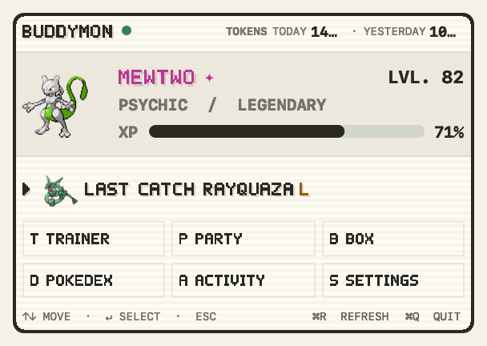

<h1 align="center">
  
</h1>

<p align="center">
  <strong>Turn local AI coding sessions into a Pokémon-style companion game.</strong><br>
  Work with Claude Code, Codex CLI, or Auggie, earn XP, and build a collection that stays on your Mac.
</p>

<p align="center">
  
</p>

<p align="center">
  <sub>The everyday menu-bar view: your buddy, progress, latest catch, and next action.</sub>
</p>

##  Start Playing

### macOS menu-bar app

BuddyMon collects new **Claude Code, Codex CLI, and Auggie** activity while the
app is open. No plugin is needed. Gemini CLI is supported for token reporting
only.

The Mac app requires **macOS 13 or newer**. The universal build includes Apple
Silicon and Intel support, and the self-contained app includes its own Python.
BuddyMon `0.2.0` is still unreleased, so there is no downloadable GitHub Release
yet. The public DMG will be linked here after final release checks pass.

For now, build from source. The build needs Git, Python 3, Apple's Swift compiler
and macOS SDK (from Xcode or Command Line Tools), and an internet connection to
prepare the bundled runtime:

```bash
git clone https://github.com/HVNT/buddymon.git ~/buddymon
cd ~/buddymon
scripts/build-macos-app.sh --friend --install --open
```

This builds for the current Mac and installs the app in Applications. See
[Development](docs/development.md) for universal builds and packaging.

BuddyMon lives in the menu bar with no Dock icon or account. On first launch:

1. Click the menu-bar buddy and choose a starter.
2. Start playing immediately. Pokémon artwork downloads automatically and
   appears as it arrives—no artwork command is required.
3. Use Claude Code, Codex CLI, or Auggie while BuddyMon is open to earn progress.

If artwork downloading stops, choose **Retry** in the app. Completed artwork
stays saved, and reopening the app resumes unfinished downloads. Returning
trainers open directly to their buddy.

### Optional Claude Code plugin

The plugin adds Claude's terminal statusline and immediate turn-end updates.
It is not needed for Codex CLI, Auggie, or normal Mac app play. After cloning
the repository above, launch `claude` and run:

```text
/plugin marketplace add ~/buddymon
/plugin install buddymon@buddymon
/buddymon:choose bulbasaur
```

Other starters are `charmander`, `squirtle`, `pikachu`, and `eevee`. The plugin
invokes `python3`, so Python 3 must be available on `PATH` before Claude starts.

##  The Loop

1. Supported local coding activity becomes XP.
2. Your buddy levels up and evolves while you work.
3. Wild encounters appear in Quick, Safari, or Battle mode.
4. Every catch becomes an individual Pokémon with a stable IV appraisal.
5. Choose favorites for your party and six-slot Showcase.

<p align="center">
  
</p>

<p align="center">
  <sub>Encounters and their results stay inside the compact native panel.</sub>
</p>

##  A Collection Worth Opening

Party, Box, Pokédex, Activity, and Showcase open directly in the terminal. On a
roomy display, BuddyMon uses a larger window and larger sprite budget; smaller
displays fall back automatically. Box keeps every caught copy distinct and
supports IV sorting and searches such as `iv:82`, `stars:3`, or `perfect`.

<p align="center">
  
</p>

<p align="center">
  <sub>A real 112-by-38 Ghostty handoff rendered from isolated demo state.</sub>
</p>

Your Showcase is a six-slot trophy room assembled from specific Pokémon in your
Box. Sharing creates a labeled PNG on your Desktop; BuddyMon never uploads it.

<p align="center">
  
</p>

<p align="center">
  <sub>An actual local Showcase export from the deterministic demo collection.</sub>
</p>

##  Works With

| Client | Game progress | Token Usage | Collection path |
| --- | --- | --- | --- |
| Claude Code | Local collection; optional plugin hooks | Yes | App, service, or `collect` |
| Codex CLI | Local collection | Yes | App, service, or `collect` |
| Auggie | Local collection | Yes | App, service, or `collect` |
| Gemini CLI | No | Yes | Read-only reporting |

The first collection anchors existing client logs instead of turning old history
into a surprise level-up. Claude's app collector and optional plugin share a
cursor, so running both does not award the same activity twice.

##  Local by Default

- Normal play reads local transcripts and local BuddyMon state.
- Game state is not uploaded and no BuddyMon account is required.
- AI-tool settings are never rewritten.
- The open Mac app collects activity automatically; collection after quitting is opt-in.
- The Mac app downloads Pokémon artwork during first launch, then uses local copies.

State, journey history, and optional packs live under
`$XDG_STATE_HOME/buddymon`, or `~/.local/state/buddymon` when
`XDG_STATE_HOME` is unset.

##  Essential Commands

Slash commands below are for the optional Claude Code plugin. Python commands
run from a source checkout; normal Mac app play does not require them.

| Command | Purpose |
| --- | --- |
| `/buddymon:status` | Show the current buddy and encounter |
| `/buddymon:mode <quick\|safari\|battle>` | Change encounter mode |
| `/buddymon:switch <name>` | Change the active buddy |
| `/buddymon:official` | Manually install artwork for plugin-only play; automatic in the Mac app |
| `python3 buddymon.py menu` | Open the terminal game |
| `python3 buddymon.py collect` | Collect new Claude Code, Codex CLI, and Auggie activity |
| `python3 buddymon.py tokens` | Show local token totals |

##  Documentation

- [macOS app](docs/macos-app.md)
- [Assets](docs/assets.md)
- [Architecture](docs/architecture.md)
- [Development](docs/development.md)
- [Public release QA](docs/release-qa.md)
- [Troubleshooting](docs/troubleshooting.md)
- [Brand styles](docs/brand.md)
- [Decisions](docs/decisions.md)
- [Changelog](CHANGELOG.md)

## License

MIT. BuddyMon is a fan-made project and is not affiliated with or endorsed by
Nintendo, Game Freak, or The Pokémon Company. Pokémon names and artwork belong
to their respective owners.
