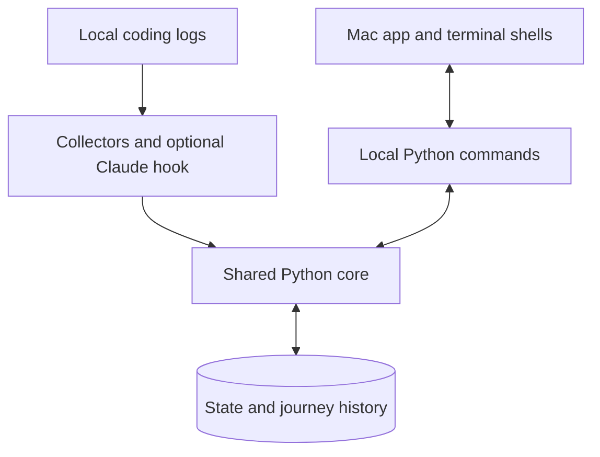
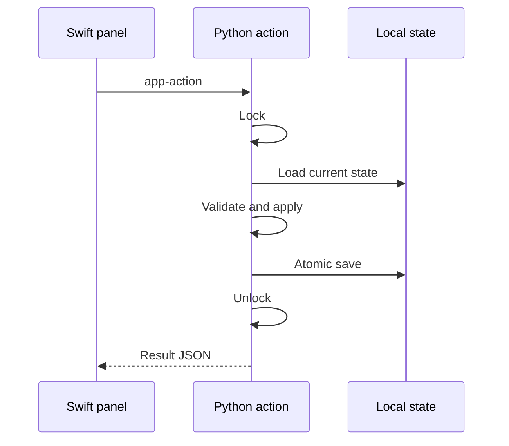
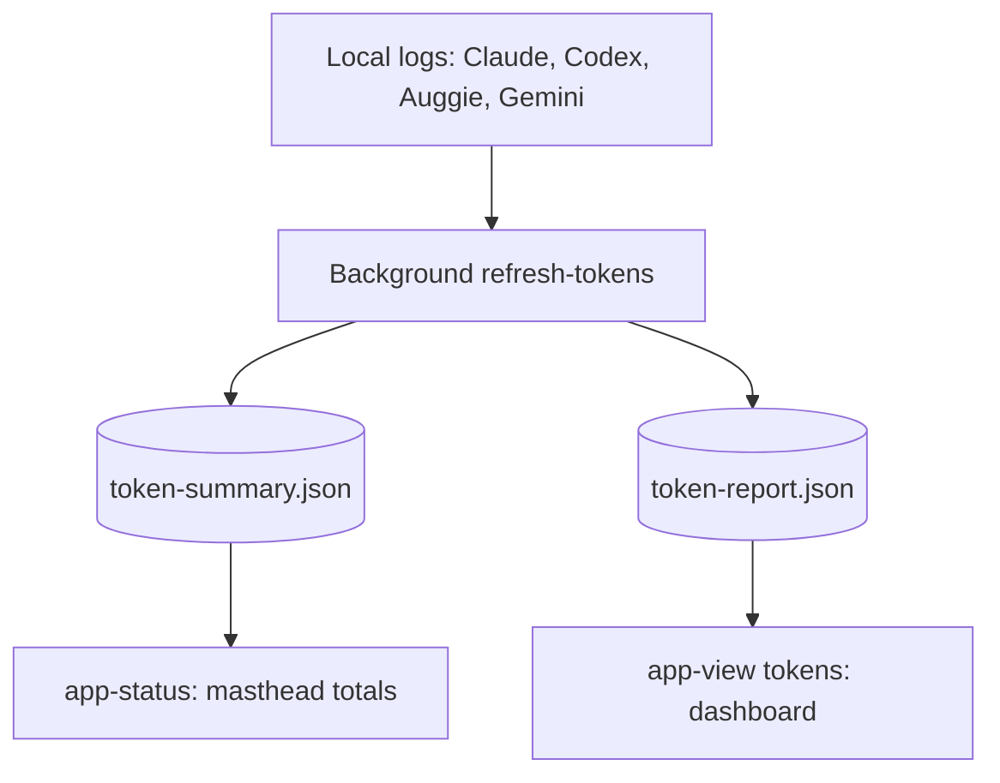

#  Architecture

**Python owns the game. Swift owns the Mac interface. Local files connect them.**

BuddyMon turns local coding activity into progress, encounters, and a collection.
The native app, terminal game, and optional integrations share the same rules
and save file. There is no BuddyMon server or account.

## The big picture

The Mac app runs Python as a local child process. A self-contained build includes
its own Python runtime; the user does not need to install one.

## Where responsibilities live

| Area | Owns | Start here |
| --- | --- | --- |
| Activity collection | Read supported logs and claim only new usage | [collectors.py](../lib/collectors.py), [transcript.py](../lib/transcript.py), [stop.py](../hooks/stop.py) |
| Game rules | XP, levels, evolution, and encounter outcomes | [engine.py](../lib/engine.py), [battle.py](../lib/battle.py), [safari.py](../lib/safari.py) |
| Persistence | Validation, migration, locking, and atomic saves | [state.py](../lib/state.py), [journal.py](../lib/journal.py) |
| Native contract | JSON payloads, read-only views, and validated actions | [app_bridge.py](../lib/app_bridge.py), [app_payloads.py](../lib/app_payloads.py), [app_views.py](../lib/app_views.py), [app_actions.py](../lib/app_actions.py) |
| Native presentation policy | Menu labels/actions and menu-bar animation sequences | [menu_panel.py](../lib/menu_panel.py), [menu_bar.py](../lib/menu_bar.py) |
| macOS shell | Child processes, status item, panel lifecycle, and rendering | [AppDelegate.swift](../macos/BuddyMonApp/Sources/BuddyMonApp/AppDelegate.swift), [BuddyMonRunner.swift](../macos/BuddyMonApp/Sources/BuddyMonApp/BuddyMonRunner.swift), [MenuPanelController.swift](../macos/BuddyMonApp/Sources/BuddyMonApp/MenuPanelController.swift) |
| Terminal and compatibility shells | Terminal screens, statusline, SwiftBar, and tmux output | [tui.py](../lib/tui.py), [tui_runtime.py](../lib/tui_runtime.py), [swiftbar.py](../lib/swiftbar.py), [buddymon.py](../buddymon.py) |
| Reports and artwork | Token snapshots, local sprites, and background art setup | [token_usage.py](../lib/token_usage.py), [assets.py](../lib/assets.py), [art_setup.py](../lib/art_setup.py) |

Native views use **`BuddyMonBrand`** for all visual treatments. Python supplies
menu policy and animation frames; Swift renders them and routes known actions.
See [Brand Styles](brand.md) for the component contract.

## From coding activity to progress

1. The open app calls `collect --scheduled` at launch and every five minutes.
   The optional LaunchAgent uses the same command.
2. Under the shared state lock, collectors read new Claude Code, Codex CLI, and
   Auggie usage. The first scan anchors existing logs without awarding old work.
3. The engine applies progress and encounter rules, records outcomes, and saves.
4. The app notices the save and refreshes its displayed state.

**Counting once:** Claude's optional turn-end hook and the app collector share
`transcript.claim_usage`. Its saved position survives inactivity and pruning of
small session caches. Only confirmed transcript deletion permits cursor cleanup;
temporary access errors do not reset it.

**Scheduling:** one timestamp checked under the state lock admits at most one
scheduled collection every five minutes across processes. Manual `collect`
runs immediately. The LaunchAgent is installed only by `collector install`.

**Client support:** Claude Code, Codex CLI, and Auggie earn progress. Gemini CLI
appears in Token Usage only.

## From a click to a saved action

The native boundary is a small set of JSON commands:

| Command | Purpose |
| --- | --- |
| `app-status` | Setup status, buddy summary, menu policy, and menu-bar sequences |
| `app-view encounter\|tokens\|trainer\|settings` | Read-only screen payloads |
| `app-action encounter\|preference` | Validate and apply a game action or exact preference value |
| `open-menu <screen>` | Hand off Party, Box, Pokédex, or Activity to the terminal |

- **Shared write lock:** collection, the Claude hook, starter/buddy commands,
  native encounter/preference actions, and terminal mutations lock, reload,
  change, and save. Terminal
  screens wait for input outside the lock, then resolve selections against fresh state.
- **No frozen panel:** `ProcessExecutor` runs child commands asynchronously,
  drains stdout and stderr, and handles timeouts and cancellation.
- **Navigation wins over late results:** encounters and tokens guard their
  responses. Trainer and Settings also track the current request: navigation,
  any panel close, or a newer detail request expires the old response. This
  covers success and error paths, including a close/reopen of the same screen.
  Preference saves still finish after leaving Settings; only their UI response
  expires. Encounter moves run one at a time.

## Keep slow work off the read path

Token reports scan local history in a background command. Opening a native
screen reads a saved snapshot instead of scanning transcripts.

Refresh runs at launch, after scheduled collection, and on Refresh. Opening
Token Usage also requests a scan when its report is missing or from a previous
day. Missing or previous-day reports show loading; same-day refreshes keep the
saved report visible until completion. A failed refresh shows an error.
Both background and terminal reports reuse a per-file cache.

Artwork setup also runs separately. Built-in art makes the game usable
immediately; downloaded species appear as they arrive. Progress lives in
`art-setup.json`, and a separate lock prevents duplicate download workers.
Status reads never download. See [Assets](assets.md) for retry and fallback rules.

## How the app stays in sync

| Mechanism | Reason |
| --- | --- |
| Watch the state directory | Saves replace `state.json` atomically, so watching its old file handle is insufficient. |
| Compare inode, size, and modification time | Journal and lock-file traffic should not trigger redundant reads. |
| Debounce and combine refresh requests | A save burst needs one passive status refresh. |
| Refresh when the panel opens; poll every 30 seconds | Give an immediate fresh view and recover from missed filesystem events. |
| Hold one native-app lock per user | A second app copy signals the existing panel and exits before creating another status item or timer. |

Menu-bar playback is independent of refresh. Python returns a **baseline**,
queued **moments**, and persistent **attention** state. Stable sequence IDs keep
refreshes from replaying old moments; Reduce Motion selects a representative frame.
The open panel keeps its captured screen position until it closes.

## Local files and safety boundaries

Active game data lives in `$XDG_STATE_HOME/buddymon`, defaulting to
`~/.local/state/buddymon`:

| File or directory | Contains |
| --- | --- |
| `state.json` | Collection, active buddy, preferences, progress, and collector positions |
| `journal.jsonl` | Journey events |
| `sessions/` | Small per-session status signals |
| `packs/`, `art-setup.json` | Downloaded artwork and setup progress |
| `token-summary.json`, `token-report.json` | Saved native token reports |
| `recovery/` | Original files preserved before a migrated save |

Manual backups go to `~/Documents/BuddyMon Backups`. The native singleton lock
always lives at `~/.local/state/buddymon/native-app.lock`, even when game data
uses a different XDG directory.

Missing state starts a new game. Existing corrupt, unreadable, invalid, or
future-version state blocks normal writes. Valid older state is backed up
before its first migrated save. Current state is version 5.

Trainer Card facts and badges are derived without mutation. IV appraisals are
derived from each caught copy's immutable ID: Party and Box display them, Box
sorts/searches them, and they never affect battle or progression. Showcase
stores selected IDs and exports a local PNG on demand.

Normal play uses local data and does not rewrite AI-tool settings or upload
game state. Artwork setup is the explicit network boundary. Visual harnesses
use demo payloads without changing trainer state or journey history.

**Next:** [Development](development.md) for commands, [Decisions](decisions.md)
for rationale, and the [Mac app guide](macos-app.md) for the player experience.
