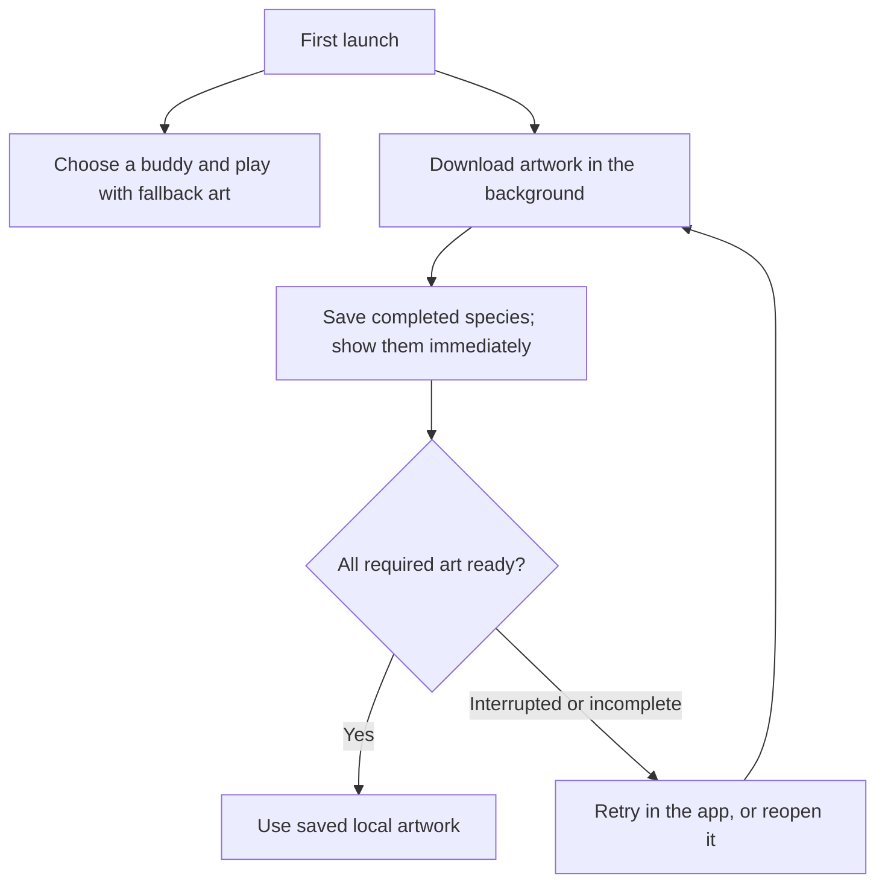

#  Assets

**The Mac app downloads Pokémon artwork automatically. Built-in art keeps it
playable while downloads run.**

BuddyMon's original branding is tracked in this repo. Downloaded Pokémon and
trainer packs live with personal state, outside the repo and app bundle.

## What lives where

| Asset | Source | Location |
| --- | --- | --- |
| Signal Buddy mascot, lockup, icons | BuddyMon originals | `docs/assets/brand/` |
| Built-in fallback sprites | BuddyMon originals | `lib/sprites.py` |
| Gen 5 Pokémon animation | PokeAPI sprite mirrors | Local `packs/gen5/` |
| Box sprites | PokéSprite-derived sources | Local `packs/box.json` |
| Gen 2 menu icons | `pret/pokecrystal` | Local `packs/gen2.json` |
| Trainer Red portrait | Pinned, checksum-verified `pret/pokefirered` source | Local `packs/trainer.json` |
| README screenshots and GIF | Shipping views with isolated demo state | `docs/screenshots/` |

The default pack directory is `~/.local/state/buddymon/packs/`.
With `XDG_STATE_HOME` set, it is `$XDG_STATE_HOME/buddymon/packs/`.
Older single-file `gen5.json` packs remain readable.

## Automatic setup and retry

- **Progress is separate from your game.** `art-setup.json` tracks the download;
  a lock prevents duplicate workers.
- **Gen 5 downloads are progressive.** The active buddy and starters are
  prioritized. Each completed species is saved atomically.
- **Regular and shiny art both count.** A failed shiny request leaves regular
  art usable but setup incomplete. Retry downloads what is still missing.
- **Older packs can repair themselves.** A background check validates older
  completion records; a saved receipt keeps later status reads cheap.
- **Refresh preserves working art on failure.** Other packs and explicit
  refreshes validate staged replacements before promotion.

Normal game commands and status reads never download artwork.

## Manual setup for plugin or CLI use

The optional Claude plugin exposes `/buddymon:official`. It asks before the
download. From a source checkout, use:

| Task | Command |
| --- | --- |
| Install missing packs | `python3 buddymon.py install-assets` |
| Refresh all packs | `python3 buddymon.py install-assets --refresh` |
| Install Trainer Red only | `python3 buddymon.py install-assets --only=trainer` |
| Refresh Trainer Red only | `python3 buddymon.py install-assets --refresh --only=trainer` |

These commands use the network. `--force` remains an alias for `--refresh`.
Results identify succeeded, skipped, and failed packs. Generated pack JSON must
not be committed.

## Fallbacks

The native status item prefers **species-specific Gen 5 frames**, then box
sprites, Gen 2 menu icons, and built-in art. Gen 2 icons can represent multiple
species, so they must not replace more recognizable art.

Trainer Card uses the local Trainer Red portrait when available; otherwise it
renders BuddyMon's original two-tone silhouette using `BuddyMonBrand`. Neither
path changes the card layout. No external trainer portrait is bundled.

Ghostty and iTerm2 can display inline PNG sprites. Other terminals use text-safe
pixel art. [Troubleshooting](troubleshooting.md#terminal-sprites) covers overrides.

## Regenerate documentation visuals

Run from the repository root:

| Output | Command |
| --- | --- |
| Original brand artwork and app icon | `scripts/render-brand-assets.sh` |
| Native screenshots and Showcase export | `python3 scripts/generate-readme-screenshots.py` |
| Battle GIF as well; requires `ffmpeg` | `python3 scripts/generate-readme-screenshots.py --battle-gif` |
| Real menu-bar item and open panel as well | `python3 scripts/generate-readme-screenshots.py --menu-bar` |
| Real Ghostty Box window | `scripts/capture-readme-ghostty.sh` |

The native generator instantiates shipping views with deterministic demo state.
The battle frames use the real battle engine with fixed random seeds; the GIF
pauses at encounter, attacks, and catch. Showcase uses the shipping PNG exporter.
Installed local art may be copied into fixtures without changing its source or
personal game progress.

**Menu-bar capture:** Screen Recording permission is required. Close the installed
BuddyMon app to avoid a second buddy, capture, then reopen it. A neutral backdrop
keeps other windows out of the shot. Inspect placement and scale on the active display.

Brand artwork uses hard alpha, nearest-neighbor scaling, and the palette in
[Brand Styles](brand.md). Pokémon art may illustrate real gameplay, but does
not replace BuddyMon's original product identity.

**Next:** [Mac app guide](macos-app.md), [Brand Styles](brand.md), or
[Development](development.md).
