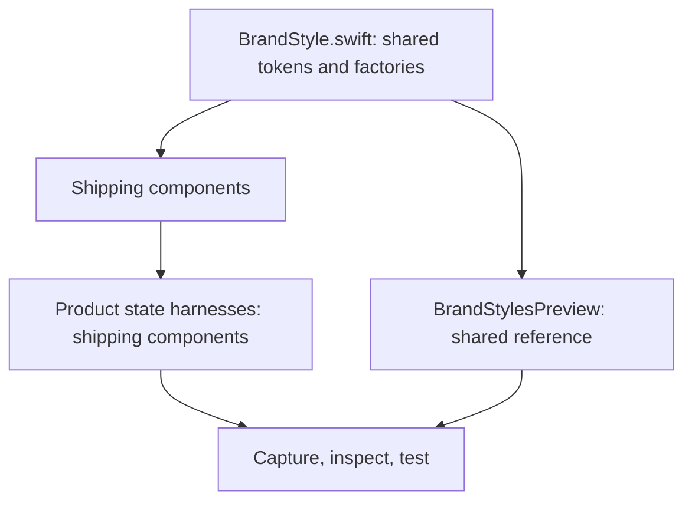

#  Brand Styles

**The native UI contract.** BuddyMon Brand is the shared system; **Field Guide**
is its compact menu-bar expression. This document is normative.

[`BrandStyle.swift`](../macos/BuddyMonApp/Sources/BuddyMonApp/BrandStyle.swift)
is the single source of truth for native colors, type, spacing, geometry,
motion, and controls. Terminal, statusline, and SwiftBar follow the same semantic
restraint and voice, but do not import AppKit tokens.

**Find a rule:** [Identity](#identity-artwork) · [Foundation](#foundation) ·
[Color](#color) · [Motion](#motion) · [Components](#component-contracts) ·
[Change workflow](#change-workflow) · [Visual QA](#visual-qa)

## Identity artwork

| Use | Composition | Rules |
| --- | --- | --- |
| Mascot | **Signal Buddy** | Mint companion, coral heart antenna, sea-glass muzzle, blueberry outline, sky-blue sparks. Preserve its face, silhouette, and colors. |
| Lockup and product mark | **Signal Peek** | Buddy rising from a friendly retro terminal. Supporting scenes may change the context, not the mascot. |
| App icon | **Signal Tile** | Face and paws above a quiet ledge inside a stepped rounded tile. Keep it readable at Dock size. |
| Small icon entries | Dedicated face-only drawing | Use at 16, 32, and 64 pixels; do not shrink the full terminal scene. |

Generate tracked artwork with `scripts/render-brand-assets.sh`. Use hard alpha,
nearest-neighbor scaling, and this exact raster palette:

| Role | Colors |
| --- | --- |
| Paper | `#F7F1DF` paper, `#FFF9E8` surface, `#E7DFC9` raised paper |
| Ink and rules | `#262236` blueberry, `#6D6678` muted, `#B9AEBD` rule |
| Buddy | `#72C7A9` mint, `#3B826F` mint shadow, `#B6E4CF` muzzle |
| Signals | `#D95462` coral, `#4F8FC7` sky |
| Supporting accents | `#398978` grass, `#D39A2C` electric |

Pokémon silhouettes and downloaded art never replace BuddyMon's product identity.
This raster palette does not authorize new native UI meanings or local palettes.

## Foundation

| Element | Contract |
| --- | --- |
| Major labels | Local FireRed/LeafGreen-inspired bitmap face: mastheads, Pokémon names, signals, section titles, actions. Light one-pixel strokes, proportional glyphs, open tracking, restrained one-pixel shadow; no font download. |
| Supporting text | SF Mono for stats, metadata, token values, keyboard help, and longer copy. |
| Alignment | Left-aligned content with stable gutters and columns. |
| Spacing | Shared `04 / 08 / 12 / 20 / 32 / 48 / 72` rhythm; major preview sections use 72 points. |
| Field Guide surfaces | Warm off-white, charcoal ink, neutral rules, soft tonal grouping. Borders are exceptional, not a wrapper around every group. |
| Terminal character | Compact information, keyboard syntax, and restrained motion—not black backgrounds or repeated ASCII decoration. |

Use `BuddyMonBrand.Menu` and shared factories such as `makeSurface`,
`makeButton`, `makeField`, `makeControlLabel`, and `pokemonColor`. Never add a
view-local palette, theme enum, hard-coded `NSColor`, direct font choice,
one-off radius, or second spacing system.

`StyleArchivePreview.swift` preserves older **Redline Mono** directions and
square large-window components. Its local values are historical only; no new
UI may copy them. Previews are not reachable from the shipping panel.

## Color

The interface must remain readable without accents. Choose semantic tokens
from `BuddyMonBrand.Menu`, such as `focus`, `alert`, `xpFill`, `dataFill`,
and `pokemonColor`.

| Color meaning | Allowed use |
| --- | --- |
| Charcoal | Focus, primary encounter actions, and Field Guide progress meters |
| Pokémon red | Urgent alerts or Fire identity |
| Blue / green | Pokémon identity or fixed rarity colors |
| Pikachu yellow | Electric identity |
| Pink | Shiny, rare-Pokémon, or shiny-achievement signals |
| Native sprite/emoji colors | Pokémon identity |

Rarity codes have one mapping: **C** common/neutral, **U** uncommon/green,
**R** rare/blue, **L** legendary/gold, **M** mythic/pink, **S** starter/cyan.
In latest-catch, battle, and result rows, the name and outcome stay neutral;
only the adjacent one-letter code carries rarity color.

Generic furniture, ordinary success, and arbitrary categories get no new
accent meaning. Pair focus, errors, loading, and destructive meaning with
borders, symbols, or copy; color alone is insufficient.

## Motion

**Compact screens and drill-ins render completely and immediately.** No
entrance fades, whole-card/row staggers, scales, or geometry transitions.
Window-level panel animation is disabled too.

| Behavior | Allowed motion | Reduce Motion |
| --- | --- | --- |
| Pokémon | State playback and quiet sprite motion | Representative frames or static presentation |
| Quick links | One-point hover lift over 120 ms | Surface feedback, no lift |
| Trainer badges | Short staggered stamp, hover emphasis, slow low-opacity shiny glow | All three motions disabled |
| Completed encounter move | Short dialogue-arrow jiggle | No jiggle; working copy still required |

Motion must never delay navigation or content visibility. The badge behavior
is component feedback, not permission to stagger whole screens.

## Component contracts

### Shared frame and navigation

| Geometry | Value |
| --- | --- |
| Panel width | 304 points |
| First Signal, Token Usage, and Settings | 304 × 210, including loading and failure |
| Striped Field Guide frame | 288 points wide; eight-point canvas reveal on each side |
| Root outer content inset | Six points |
| Drill-in content inset | Ten points |
| Quick links | 22-point height; square, no resting fill, subtle neutral rule |
| Primary and encounter actions | Standard 32-point treatment |

Root, Tokens, Settings, Battle, and Battle Result use the same striped frame
as Trainer Card. Share one border, surface, section rhythm, and display masthead;
do not add nested containers or an expanded native dashboard.

Returning drill-ins use **one back chevron and display title on the leading
row**, with useful trailing context such as Trainer ID. Back is first in keyboard
order; do not repeat it as a bottom Back or Return Home button. Interactive
controls use pointing-hand cursors; passive content keeps the normal arrow.

The panel snapshots its screen-space anchor when it opens. Refresh, animation,
and drill-ins reuse it until close; reopening captures the new position.

Trainer and Settings results must belong to the current visit and request.
Back, Escape, outside click, another destination, or a newer request makes old
success and error responses ineligible to redraw or reopen the panel. Leaving
Settings does not cancel a preference save already requested.

### Root panel

| Part | Contract |
| --- | --- |
| Masthead | Small bitmap `BUDDYMON` wordmark, no decorative leading icon. |
| Health dot | Steady six-point dot: green active local status, neutral starting/loading, red unavailable. Never blink; health is independent of starter selection. |
| Token summary | Clickable Tokens, Today, Yesterday on one right-aligned baseline; no background, no separate Open label, no second token card. Label smaller than values. |
| Buddy row | Full 288-point width, square edges, subtle one-point top/bottom rules. One six-point padding layer, 54-point sprite, fixed 66-point row. No nested background or sprite well. |
| Identity | Three rows; level and XP percentage share a right edge. XP bar fills between label and value. The group ends after XP; no trainer-total row. |
| Navigation | Six accessible link controls in a square 3-by-2 grid: Trainer, Party, Box, Pokédex, Activity, Settings. |
| Utilities | Tiny `⌘R` Refresh and `⌘Q` Quit footer commands, not action cards. |

Minimum-height slack must not stretch the buddy row's bottom perimeter.

**Latest catch:** chevron at the content edge, then explicit columns for sprite,
neutral `LAST CATCH`, name, and rarity. Do not align with spaces inside a string.

**Waiting wild:** combine message and primary action into one dark clickable row
with shortcut, sprite, name, and waiting state. No repeated signal above it.
Reserve a 24-point leading sprite column inside the padding so it never crops
or overlaps the label.

### First Signal and artwork

Five starter choices use the 22-point quick-link treatment in a 3-by-2 grid:
small identity-color mark, neutral action text. Choosing, working, and error
states keep the standard compact frame; no dark console or larger setup window.

Artwork uses `BuddyMonBrand.Menu.makeArtworkStatus`. Preparing/downloading
is disabled progress text; interruption becomes a keyboard-accessible **Retry**
control. Update First Signal in place to retain starter focus. Remove the root
status after completion. Preview preparing, downloading, retry, and ready states.

### Token Usage

All loading, success, and failure states stay inside the Field Guide card.
Missing or previous-day reports show the shared loading component with Back
available; the completed report fills automatically. Same-day refreshes retain
the saved report. Failed refreshes show the error state.

1. Two equal comparison cards: **Today / Yesterday** and **This Week / Last Week**.
   Each keeps its percentage beside the title and the earlier period below the total.
2. Seven-day proportional bars in a 52-point pulse with a 27-point drawable range.
3. One context line: daily average, peak day, active streak.
4. Supported-tool share, anchored at the bottom.

Use the structured local dashboard payload; never parse terminal report copy.
This read-only screen has no generic arrow/Return selection footer. Back and
Escape remain available.

### Settings

All seven preferences appear in one list, each with a leading label and **every
allowed value on the same 18-point row**. Every value is an individual text control.

- Resting controls have no fill or rounded button chrome.
- Active values are darker, bold, underlined, and prefixed with a chevron.
- Each option owns its full pointing-hand hit target; hover may add a transient
  wash, and keyboard focus uses a square ink outline.
- Click or Return sends the exact Python-validated value and refreshes in place.
- Backup and setup are operations, not preferences.

### Trainer Card

The **288 × 192, 3:2 card** uses the shared striped surface and factories.
Its order is header → facts/portrait → status rail → badge rail.

| Part | Contract |
| --- | --- |
| Facts | NAME, TOKENS, POKÉDEX, CAUGHT; fixed label/value columns and a separate trailing portrait column. No trainer level. |
| Portrait | Local Trainer Red when installed; otherwise the original two-tone silhouette in shared ink colors. Same geometry; no external portrait bundled. |
| Status rail | Mode, streak, balls, owned shinies in equal columns; Battle shows unlimited balls. A 26-point raised rail with subtle rules spans the full card to both borders, intentionally breaking the ten-point content gutter. |
| Badge rank | `RANK` and four stars on the header's right; one star per two of eight core badges. |
| Medallions | Evenly spaced 28-point circles; 25 points with ten badges. Shared zero-offset glyph centering. |
| Selection | Keyboard/pointer controls replace the left `BADGES` heading with the selected name. Styling shows earned/locked; tooltips keep name and requirement. Selection does not change game state. |

Show Bond, Safari, Battle, Curator, Type, Shiny, Legend, National, and Shiny Legend.
**Omit Shiny National entirely until National is earned**, then show it locked or
earned as the tenth badge. Capture both badge counts.

The badge rail stays bottom-anchored. Flexible space is only a fallback for old
payloads lacking trainer stats; it never goes below the badge rail. Use the
shared motion rules above, including static Reduce Motion behavior.

### Encounter and result

Keep two sprite identities, optional HP bars, one dialogue line, one move row,
and a compact result. Pokémon identity and the current signal take priority
over repair/setup controls. Names and outcome copy stay neutral beside their rarity code.

**Encounter moves are single-flight.** Selecting a move immediately shows
action-specific working copy, emphasizes that move, and disables all moves
until the response returns. Restore focus to the selected move if the encounter
continues. Back, Escape, and close remain available; late responses never reopen
an abandoned panel. Completed-move feedback follows the Motion rules.

### Menu-bar status item

- Use shared `menuBarIconHeight`, preserve sprite colors, and never template-tint
  art. Text/chrome stay macOS-native; every frame has an accessibility label.
- Prefer the same species-specific Gen 5 source as the panel. Legacy shared
  menu icons do not displace recognizable art.
- Short work, progress, catch, battle, and evolution moments may animate;
  persistent attention settles and every sequence has a Reduce Motion frame.
- Catch action may show the wild, but its result returns to the active buddy.
  Keep the caught species visible in the panel's latest-catch row.
- Attention uses one integrated alert mark, not another adjacent `!`. Working
  uses a quiet bob without an adjacent bullet.

### Terminal handoffs

| Profile | Window | Ghostty grid |
| --- | --- | --- |
| Roomy | 1040 × 680 | 112 × 38 |
| Medium | 920 × 600 | 100 × 34 |
| Compact | 760 × 520 | 88 × 30 |

Choose the largest profile that fits the current display. Roomy layouts may
use larger sprites; compact layouts retain their art budget. Content must not
overflow the selected grid.

## Change workflow

1. Change the shared token or treatment first, then consume it in shipping UI.
2. Cover every relevant state in `BrandStylesPreview.swift` or the product
   harness. Render actual shipping components, not lookalikes.
3. Update this contract; update [Decisions](decisions.md) if the meaning changes.
4. Update native source tests and inspect the captures below.

## Visual QA

| Command | Output |
| --- | --- |
| `scripts/capture-brand-styles.sh` | `.build/brand-styles.png` |
| `scripts/capture-menu-bar-states.sh` | `.build/menu-bar-state-harness.png` |
| `scripts/capture-menu-panel.sh` | `.build/menu-panel.png` |
| `scripts/capture-menu-panel-states.sh` | `.build/menu-panel-states.png` |

The menu-bar harness covers light, dark, selected, and reduced-motion states.
The panel harness covers setup, loading/error, ready/recent/encounter, shiny,
long values, unavailable/recovery, Tokens, Settings, battle/results, local trainer
portrait, and National-complete Trainer. The current-panel capture reads local
`app-status`; none of these captures changes game state.

Native tests render twice and require byte-identical output, canonical sizes,
component inventory, and contrast rules. [Development](development.md#change-native-ui)
includes interactive playback and capture commands.

Before calling a native visual change ready:

- [ ] Alignment, gutters, and section spacing use the shared system.
- [ ] Every accent has an approved identity, rarity, progress, or alert meaning.
- [ ] Focus, disabled, loading, empty, error, selected, and destructive states
  are covered where applicable; important meaning is not color-only.
- [ ] Emoji, built-in sprites, and local PNG variants fit the same component.
- [ ] Keyboard navigation, pointing-hand targets, macOS shortcuts, and Reduce
  Motion work; navigation never waits on an entrance animation.
