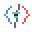
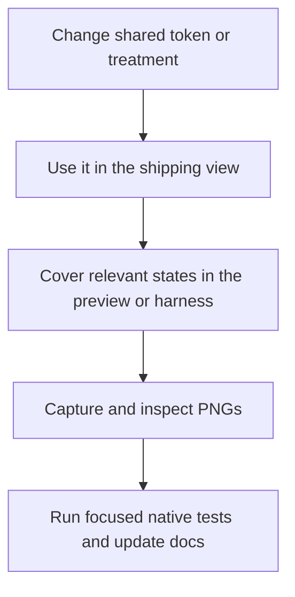
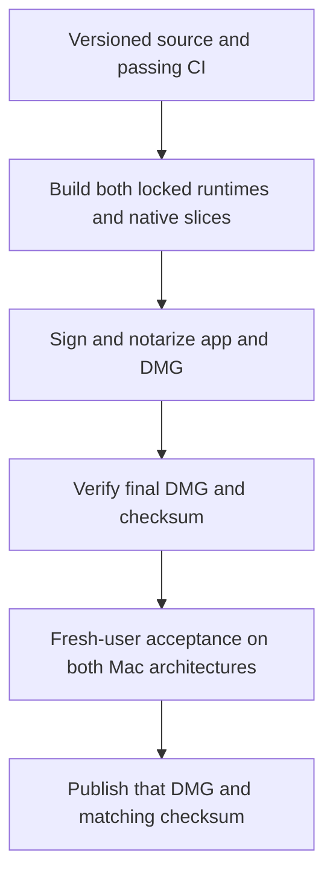

#  Development

**Build locally, test the shared Python core, then inspect the native surfaces
you changed.** Run the commands below from the repository root on macOS.

Need the code map first? Read [Architecture](architecture.md).
For ordinary app use, start with the [Mac app guide](macos-app.md).

## Start here

You'll need Git, Python 3, and Xcode or Command Line Tools with Swift and the
macOS SDK. Self-contained builds also need internet access to prepare the
bundled runtime. `uv` is used in the test examples.

```bash
# Run the Python tests with their development dependencies.
uv run --with pytest --with pillow --no-project python3 -m pytest tests/ -q

# Build a native development app.
scripts/build-macos-app.sh
open .build/macos/BuddyMon.app
```

Normal game code stays stdlib-only where practical. Pillow supports artwork
import/export and sprite tooling; the self-contained app bundles it.

Navigation regression tests run the real app delegate and command runner with
a nonvisual presenter. They must not create menu-bar icons, open windows, or
take focus from the desktop.

## Choose a build

| Goal | Command | Result |
| --- | --- | --- |
| Quick local development | `scripts/build-macos-app.sh` | App using this Mac's `/usr/bin/python3` |
| Self-contained app for this Mac | `scripts/build-macos-app.sh --friend` | App with a private Python/Pillow runtime |
| Install and open that build | `scripts/build-macos-app.sh --friend --install --open` | Replaces `/Applications/BuddyMon.app` |
| One build for Apple Silicon and Intel | `scripts/build-macos-app.sh --universal` | Both native slices and both locked runtimes; macOS 13+ |
| Unsigned local DMG candidate | `bash scripts/create-macos-dmg.sh` | App plus an Applications shortcut |

`--install` stops the running BuddyMon process before replacing its bundle.
Otherwise a second launch may just signal an old in-memory copy.

For a universal build, use Apple Silicon with Rosetta installed so the builder
can verify the Intel runtime. Users run the matching native slice; they do not
need Rosetta. A local build or unsigned DMG is not a public release.

### Runtime options

Default inputs are pinned by URL, version, architecture, and SHA-256 in
[`runtime-lock.json`](../scripts/runtime-lock.json). Managed runtimes live under
`.build/python-runtime` for single-architecture builds and `.build/python-runtimes`
for universal builds. They are reused only when metadata and imported versions
still match the lock. Replacements are validated in staging.

| Need | Option |
| --- | --- |
| Rebuild the managed runtime | `--friend --force-runtime` |
| Request the locked Python version explicitly | `--friend --python-version 3.12.13` |
| Supply a runtime | `--friend --runtime-dir /path/to/runtime`, or `BUDDYMON_PYTHON_RUNTIME` |
| Supply universal runtimes | `--universal --runtime-dir /path/to/runtimes` with `arm64/` and `x86_64/` children |
| Use an intentional unlocked development runtime | Explicit path **and** `--allow-unlocked-runtime`; never used by CI or public packaging |

Custom runtime archive URLs or tarballs passed to `scripts/build-python-runtime.sh`
require `--sha256`. The builder does
not rewrite unmarked external runtimes; managed ones have `buddymon-runtime.json`.

## Inspect the Python boundary

| Task | Command |
| --- | --- |
| Current native status | `python3 buddymon.py app-status --pretty` |
| Native screen payload | `python3 buddymon.py app-view trainer` — also `encounter`, `tokens`, `settings` |
| Set an exact preference | `python3 buddymon.py app-action preference mode quick` |
| Menu-bar fixtures | `python3 buddymon.py app-menu-bar-harness --pretty` |
| Compact-panel fixtures | `python3 buddymon.py app-menu-panel-harness --pretty` |
| Terminal game | `python3 buddymon.py menu` |
| Token report | `python3 buddymon.py tokens` |
| Immediate collection | `python3 buddymon.py collect` |
| Other local views | `python3 buddymon.py status`, `dex --list`, or `preview` |

`app-status`, the four `app-view` routes, and `app-action encounter|preference`
are the stable native JSON boundary. Party, Box, Pokédex, Activity, and Showcase
are terminal screens. Async child-process handling lives in `ProcessExecutor`.

## Change native UI

Read [Brand Styles](brand.md) before editing. All native visuals use
`BuddyMonBrand`; the preview must render the same factories as shipping views.



| Capture | Command | Output |
| --- | --- | --- |
| Shared brand reference | `scripts/capture-brand-styles.sh` | `.build/brand-styles.png` |
| Menu-bar state catalog | `scripts/capture-menu-bar-states.sh` | `.build/menu-bar-state-harness.png` |
| Current compact panel | `scripts/capture-menu-panel.sh` | `.build/menu-panel.png` |
| Compact product states | `scripts/capture-menu-panel-states.sh` | `.build/menu-panel-states.png` |

Run `scripts/menu-bar-state-harness.sh` for interactive Play/Pause/Restart.
`StyleArchivePreview.swift` is historical, not a source of new UI values.
Developer previews and snapshot sources are excluded from self-contained builds.

### Play states on the real menu-bar buddy

Build and open the current app first, then run:

```bash
scripts/menu-bar-demo.py list
scripts/menu-bar-demo.py play evolving
scripts/menu-bar-demo.py story evolution
scripts/menu-bar-demo.py story interactive-retry
scripts/menu-bar-demo.py story all-stories --speed 2
scripts/menu-bar-demo.py story all-states --speed 2
scripts/menu-bar-demo.py reset
```

Fixtures use Charmander as the starter and Eevee as the wild. `all-stories`
covers narrative sequences; `all-states` shows each catalog state once. Playback
uses production frames and installed local art, does not change trainer state
or open the dropdown, and returns to the latest live status. Relaunch after a rebuild.

### Refresh README visuals

[Assets](assets.md#regenerate-documentation-visuals) lists native screenshots,
menu-bar captures, the battle GIF, and the Ghostty Box capture. They use isolated
demo state. Inspect the output before committing; do not commit fixture state
or copied packs.

## Collection service

The app and optional LaunchAgent run `collect --scheduled`. A shared locked
five-minute gate limits scheduled work; plain `collect` runs immediately.
Per-file saved positions prevent duplicate awards. When changing Claude token
accounting, test both app-first and plugin-first collection.

```bash
python3 buddymon.py collector install
python3 buddymon.py collector status
python3 buddymon.py collector uninstall
```

Installation is explicit. It generates `io.github.hvnt.buddymon.collector.plist`
in `~/Library/LaunchAgents/` from the current Python runtime, script path, and
`XDG_STATE_HOME`. In tests, use a temporary home and injected runner; do not
install the real service.

## Artwork development

The app runs `setup-artwork` in the background. Test downloads with a disposable
`XDG_STATE_HOME`; status-only tests must stay network-free. Progress is separate
from game state, and retry reuses completed species.

| Tool | Purpose |
| --- | --- |
| `python3 buddymon.py install-assets` | Install missing packs |
| `python3 buddymon.py install-assets --refresh` | Explicitly refresh packs |
| `uv run --with pillow --no-project python3 tools/fetch_official.py` | Gen 2 menu icons |
| `uv run --with pillow --no-project python3 tools/fetch_box.py` | Box sprites |
| `uv run --with pillow --no-project python3 tools/fetch_gen5.py` | Gen 5 animation |
| `python3 tools/fetch_trainer.py` | Trainer portrait |

See [Assets](assets.md) for sources, validation, and fallback behavior.
Generated packs belong in local state, never in the commit.

## Package a public release



`VERSION` is canonical. During development, metadata validation accepts a dated
version entry or an unreleased changelog. Public packaging requires the version's
real publication date before rebuilding:

```bash
python3 scripts/validate-release-metadata.py
python3 scripts/validate-release-metadata.py --app .build/macos/BuddyMon.app
```

With an existing Developer ID Application identity and saved `notarytool`
profile configured through Apple's tools:

```bash
BUDDYMON_CODESIGN_IDENTITY="Developer ID Application: ..." \
BUDDYMON_NOTARY_PROFILE="buddymon-notary" \
scripts/package-macos-release.sh
```

The packager rebuilds and verifies locked inputs, enforces production bundle
metadata, signs Mach-O files with Hardened Runtime, and notarizes/staples both
the app and final DMG. It then verifies the mounted artifact and checksum.
It does not discover credentials or publish a GitHub release.

**Public files:** `.build/release/BuddyMon-macOS.dmg` and its `.sha256` file.
The intermediate ZIP is only for app notarization. Complete
[Public Release QA](release-qa.md) before upload.

## Before pushing

```bash
uv run --with pytest --with pillow --no-project python3 -m pytest tests/ -q
python3 scripts/validate-release-metadata.py
scripts/build-macos-app.sh
git diff --check
git status --short
```

CI runs tests, build, and metadata gates on macOS for PRs and `main` pushes,
plus locked self-contained runtime verification. Add relevant visual captures
for native UI changes. Keep personal state, generated packs, and unrelated
worktree edits out of the commit.
