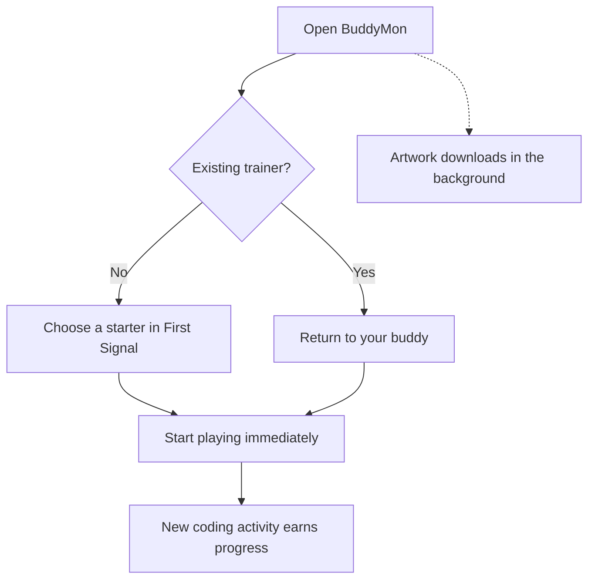
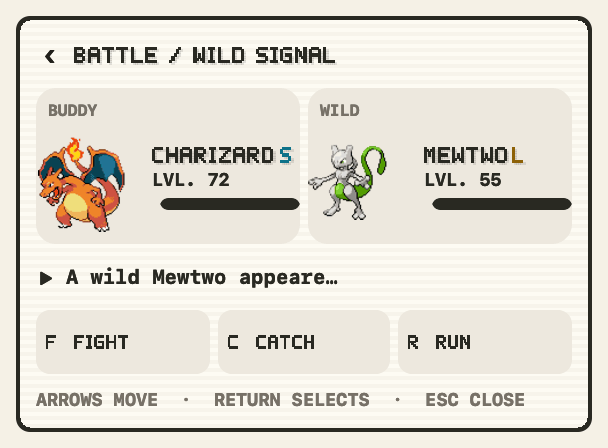

#  Mac App Guide

**Keep BuddyMon in your menu bar. Code, earn progress, and check on your buddy.**

The app collects new **Claude Code**, **Codex CLI**, and **Auggie** activity while
it is open. No plugin or BuddyMon account is needed. Gemini CLI contributes to
Token Usage only.

  

## Open BuddyMon

BuddyMon requires **macOS 13 or newer**. The self-contained app includes Python;
the universal build supports Apple Silicon and Intel.

`0.2.0` is still unreleased. Follow [Build from source](../README.md#build-from-source)
until the public download is available. Installed copies live in
**Applications → BuddyMon**.

- **Look in the menu bar.** There is no Dock icon or separate main window.
- **Click the buddy** to open or close the panel. Click outside or press Escape
  to close the panel while leaving BuddyMon running.
- **Open the app again** to bring up the existing copy, rather than a second buddy.
- To start at login, add BuddyMon in **System Settings → General → Login Items**.

## First launch

Choose Bulbasaur, Charmander, Squirtle, Pikachu, or Eevee. Built-in art works
immediately; Pokémon artwork appears as it downloads. **No artwork command is
required.** If a download pauses, click **Retry** or reopen the app. Completed
artwork and your progress stay saved.

The first collection marks where your existing logs end. Create new coding
activity after that scan to earn progress. Automatic collection runs every
five minutes while BuddyMon is open; the optional Claude plugin can also
collect at the end of each turn.

## Find your way around

| Open | What you get | Where it opens |
| --- | --- | --- |
| Buddy | Active Pokémon, level, XP bar, and latest catch | Main panel |
| Tokens in the header | Today/Yesterday, week comparison, daily bars, and tool totals | Native panel |
| Trainer | Collection facts, streak, shinies, and earned badges | Native panel |
| Settings | All seven preferences and their available values | Native panel |
| Waiting encounter | Moves and the encounter result | Native panel |
| Party, Box, Pokédex, Activity | Your team, collection, species, and journey | Terminal window |

**Controls:** arrows move focus; Return or Space selects; Escape closes.
Visible letter shortcuts also work. **⌘R** refreshes; **⌘Q** quits.
Drill-in screens have a back chevron in their title row.

If you leave Trainer or Settings while it is loading, a late result will not
bring it back. Preferences you already selected still save after you leave.

The panel stays in place during refreshes and navigation. The menu-bar buddy
shows work, progress, catches, and evolution; macOS **Reduce Motion** replaces
animated sequences with representative frames.

## Encounters

| Mode | How it plays |
| --- | --- |
| **Quick** — default | Ordinary encounters resolve automatically. Every shiny and legendary/mythical waits for you; non-shiny rare encounters remain automatic. |
| **Safari** | Every wild waits for your choice. Uses Safari ball inventory. |
| **Battle** | Every wild waits for moves. Weaken it, try a catch, or run. Battle throws do not consume Safari balls. |

  

*Demo battle captured from the real game and native views.*

Choosing a move shows working feedback and prevents duplicate moves. Back and
Escape remain available; a result arriving later will not reopen a closed panel.

## Trainer Card and Token Usage

**Trainer Card** shows your name, tokens, Pokédex progress, caught copies, mode,
streak, balls, shinies, and badges. Select a badge to see its name; its tooltip
explains the requirement. Rank awards one star per two core badges—there is no
trainer level. Shiny National appears only after National is earned.

**Token Usage** scans history in the background. On its first scan, loading
stays responsive and the report appears automatically. Same-day refreshes keep
the saved report visible; a new day needs a fresh report. Going Back or closing
the panel cancels no game progress and will not be undone by a late report.

## Optional terminal play

Party, Box, Pokédex, and Activity open the terminal game at the selected screen.
You can also curate a six-slot Showcase there and export a PNG locally.

Choose **Menu launcher** in Settings to use an installed terminal. Ghostty and
iTerm2 support inline PNG art; other terminals use text-safe art. The window
adapts to the display and leaves the native panel open. See
[Troubleshooting](troubleshooting.md#terminal-handoffs) if a handoff fails.

## Your data

Progress, journey history, and packs stay in `$XDG_STATE_HOME/buddymon`, or
`~/.local/state/buddymon` by default. BuddyMon does not upload game state or
rewrite your AI-tool settings.

- **Back up:** use **Back up my data** in Terminal Settings, or
  `python3 buddymon.py backup` from a source checkout. Backups go to
  `~/Documents/BuddyMon Backups`.
- **State Needs Care:** the existing save is left untouched. Follow
  [state recovery](troubleshooting.md#state-needs-care) before changing it.
- **Collect while the app is closed:** explicitly install the optional
  [collection service](development.md#collection-service). It is never added
  during onboarding.

**Next:** [Troubleshooting](troubleshooting.md) for problems,
[Assets](assets.md) for artwork, or [Architecture](architecture.md) for internals.
