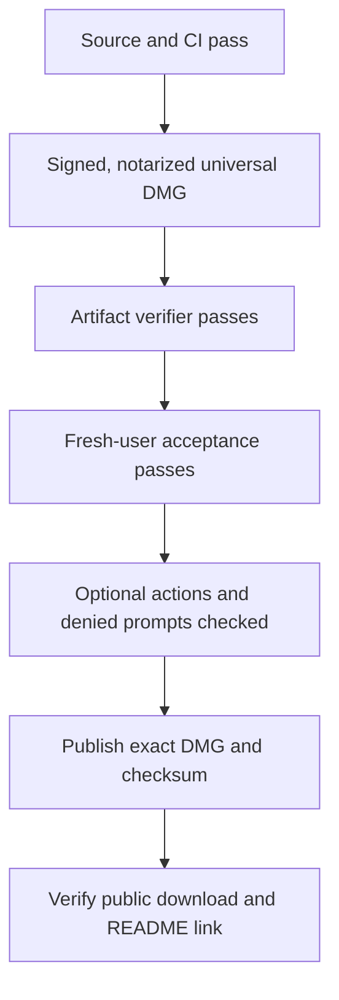

#  Public Release QA

**Verify the exact download, then test it as a new user.** Passing unit tests or
notarization alone does not prove the install experience. This is a checklist,
not a claim that any current candidate has passed.



## 1. Prepare and verify the artifact

- [ ] Set the version's real publication date in the changelog. Public packaging
  rejects an unreleased marker before rebuilding.
- [ ] Confirm CI passed for the release commit.
- [ ] On the authorized release Mac, use an existing Developer ID identity and
  saved notary profile:

```bash
BUDDYMON_CODESIGN_IDENTITY="Developer ID Application: ..." \
BUDDYMON_NOTARY_PROFILE="buddymon-notary" \
scripts/package-macos-release.sh
```

- [ ] Verify the exact DMG and checksum intended for upload:

```bash
python3 scripts/verify-release-archive.py \
  .build/release/BuddyMon-macOS.dmg \
  .build/release/BuddyMon-macOS.dmg.sha256
```

The verifier checks checksum, layout, release metadata, both runtime locks,
code signatures, stapling, Gatekeeper assessment, and an embedded-Python
`app-status` run using disposable state. [Development](development.md#package-a-public-release)
explains the packaging stages.

## 2. Fresh-user acceptance

Use a **clean, non-admin account or VM on macOS 13+**, starting on Apple Silicon.
Do not copy in BuddyMon state, packs, a LaunchAgent, or a Claude profile.
Record the OS version, architecture, candidate checksum, and system dialogs.

| Check | Pass condition |
| --- | --- |
| Download and install the candidate | Check its SHA-256, open the DMG, drag BuddyMon to Applications, and open it. Test the delivered file, not the build directory. |
| First open | No unidentified-developer warning; no privacy, Automation, notification, or network-art prompt before First Signal. The app uses a menu-bar item and opens First Signal, with no Dock icon. |
| Choose and keep a starter | First Signal appears after status resolves. Built-in art works immediately. Quit/reopen preserves the starter and does not replay setup. |
| First token report | Loading stays responsive; totals appear automatically. Back/close during scanning is respected when the result arrives. |
| Interrupted artwork | Disconnect, see Retry, reconnect, and resume. Quit mid-download, reopen, and retain completed species. No LaunchAgent is created. |
| Missing shiny artwork | Fail a shiny request after regular art succeeds. Regular art stays visible; Retry fetches the shiny; completion is not claimed early. An older regular-only pack repairs automatically. |
| Claude without a plugin | Create activity after the initial scan and verify progress while the app is open. |
| Claude with a plugin | Add the optional plugin and verify that the same activity is counted once. |
| Intel Mac | Repeat startup and collection natively. A Rosetta runtime probe does not replace Intel acceptance. |

Compare the downloaded candidate with its matching checksum:

```bash
shasum -a 256 BuddyMon-macOS.dmg
```

## 3. Optional actions and expected prompts

Exercise each deliberately. A denied or cancelled prompt must leave BuddyMon
usable and preserve game state.

| Action | Evidence to record |
| --- | --- |
| `/buddymon:official` or `install-assets` | Explicit plugin/CLI setup or refresh works; native onboarding already downloads missing packs. No downloaded pack is bundled. |
| `collector install`, then `collector uninstall` | Only BuddyMon's per-user LaunchAgent is added/removed. Record any service prompt. |
| Enable notifications with `terminal-notifier` available | Record consent or the absence of a dialog. Disabling notifications stops delivery. |
| Open Ghostty, iTerm2, and Terminal.app handoffs where installed | Record Automation prompts; test Allow and Do Not Allow. The native app stays usable. |
| Export and reveal Showcase | Record Desktop/Finder prompts. Cancellation preserves game state. |

## 4. Publish gate

- [ ] Artifact verification, fresh-user acceptance, optional-action checks,
  and CI are recorded as passing for the candidate.
- [ ] Attach the universal **DMG and matching `.sha256`** to `vMAJOR.MINOR.PATCH`.
- [ ] Download the public attachment and confirm its checksum matches the tested
  candidate. Confirm the README's download link serves that artifact.

Record these facts with the release notes:

| Evidence | Record |
| --- | --- |
| Source | Version, tag, commit, CI run |
| Artifact | DMG filename and SHA-256 |
| Machines | macOS version and architecture for each acceptance run |
| User experience | Install result, artwork retry, collection, and token-loading result |
| Permissions | Dialog screenshots and Allow/Do Not Allow or cancellation outcomes |

**Next:** [Development](development.md) for packaging commands or
[Troubleshooting](troubleshooting.md) for failures.
